# Dashling

[](https://github.com/sateesh2020/dashling/actions/workflows/ci.yml) [](https://sateesh2020.github.io/dashling/) [](LICENSE)

<p align="center">
  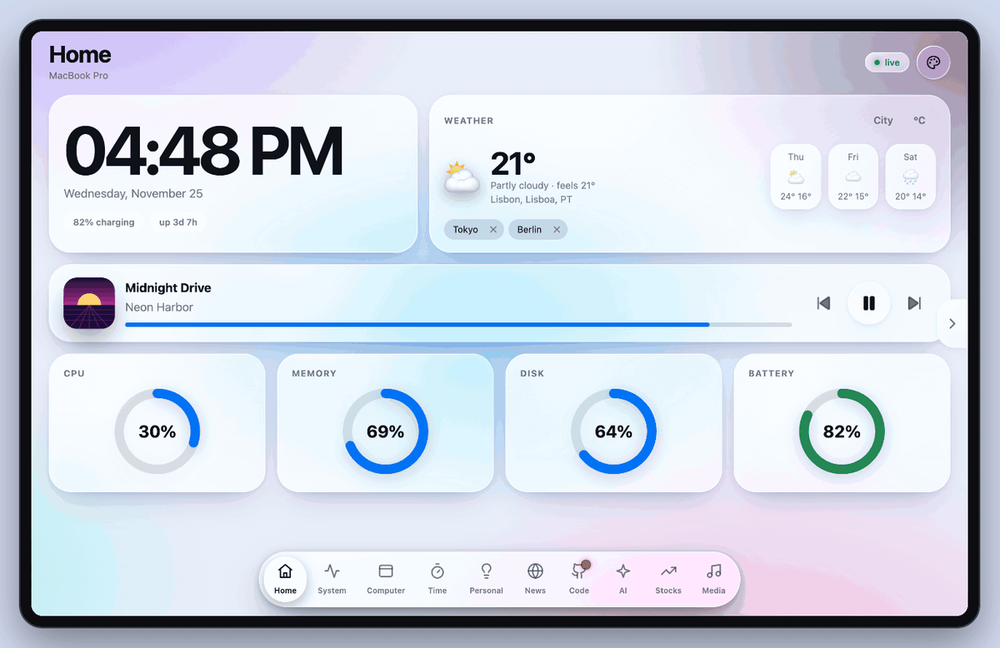
</p>
<p align="center"><sub>Every screenshot in this README is the built-in demo, which uses fictional data.</sub></p>

A desk-panel web app for your **phone or tablet** (iPhone, iPad and Android). It shows live stats and controls for the computer on your desk (macOS, Linux or Windows), plus weather, news, clocks, a photo frame and more, served from a locked-down Docker container that you run yourself.

- **iPhone / iPad:** open it in Safari, tap **Share > Add to Home Screen**, and it runs full-screen like an app.
- **Android:** install the **Dashling app** (an APK from the [Releases page](https://github.com/sateesh2020/dashling/releases/latest)): full screen, kiosk style, keeps the screen on while charging. Or just open it in Chrome. See [Android](#android-app-recommended) below.
Inspired by [ersinkoc/phonebox](https://github.com/ersinkoc/phonebox) (Android); this is an independent rewrite with its own code and name.

## See it first

**Try it in 10 seconds, with no computer to connect and no Docker.** You need [Node.js](https://nodejs.org) 22 or newer:

```sh
git clone https://github.com/sateesh2020/dashling.git && cd dashling
npm run demo        # then open http://localhost:8799 and enter the pairing code 123456
```

It serves the real panel with invented data (a pretend MacBook, a pretend city, fictional music, news and projects). It listens on `localhost` only; to try it on a phone on the same Wi-Fi, run `DEMO_HOST=0.0.0.0 npm run demo` and open `http://<your-computer-ip>:8799`. Or just resize the browser window.

### On your phone

<p align="center">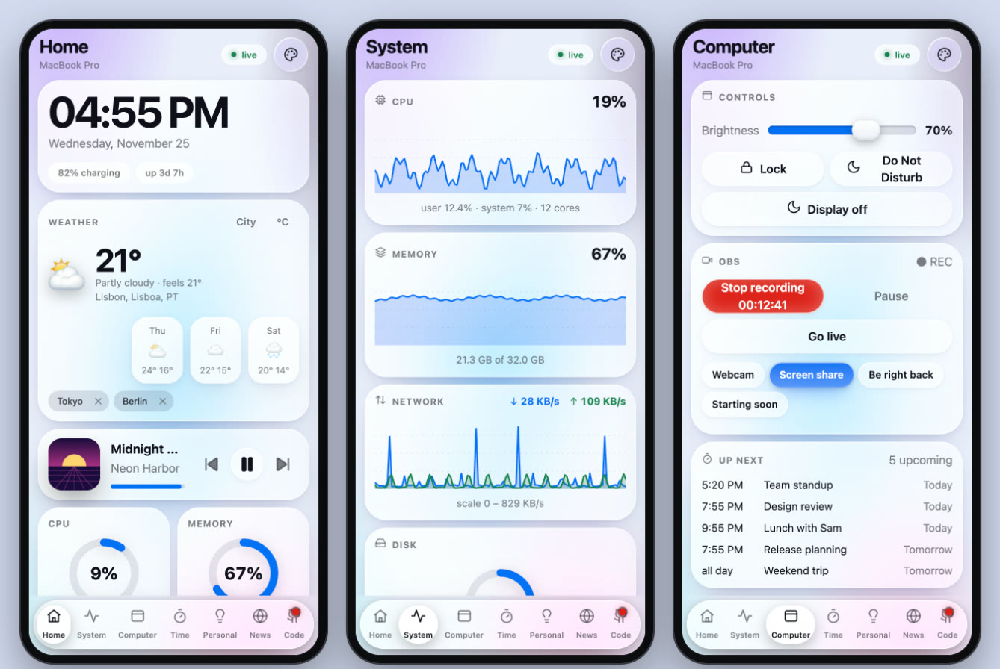</p>

### On a tablet or a second screen

<table>
  <tr>
    <td width="50%"><a href="docs/img/system.jpg">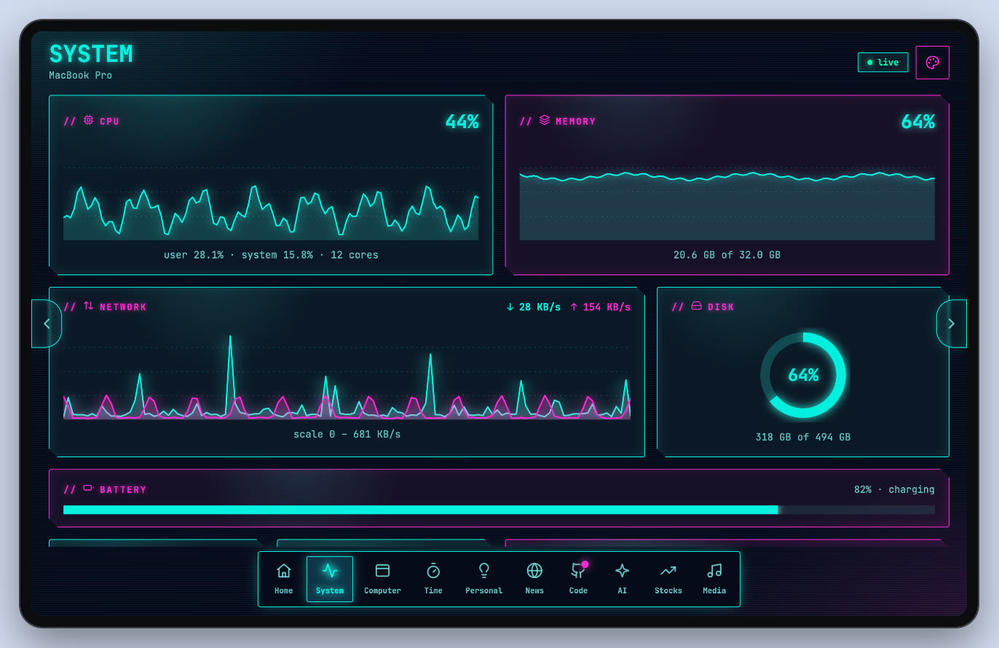</a><br><sub><b>System.</b> Live CPU, memory and network graphs, temperatures, fans, power draw and the top processes (you can quit your own).</sub></td>
    <td width="50%"><a href="docs/img/computer.jpg">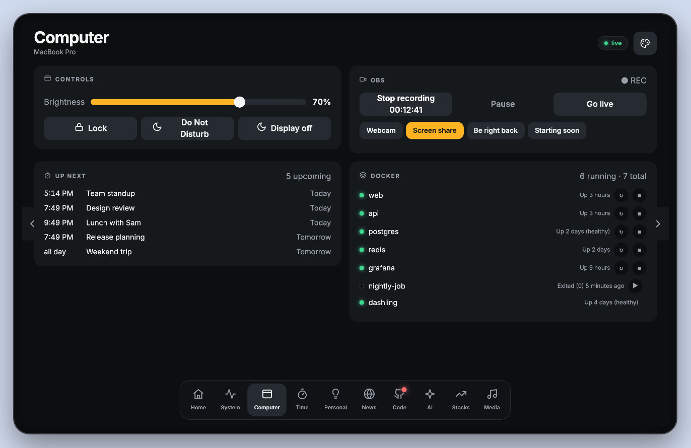</a><br><sub><b>Computer.</b> Brightness, lock, OBS recording and scenes, your calendar, and Docker start, stop and restart.</sub></td>
  </tr>
  <tr>
    <td><a href="docs/img/time.jpg">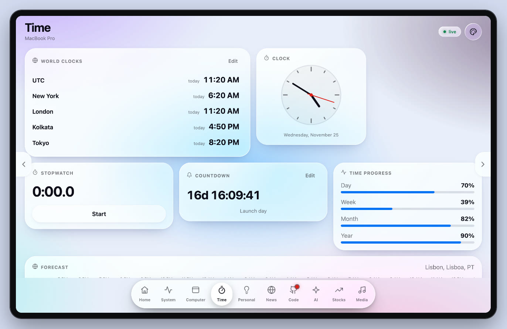</a><br><sub><b>Time.</b> World clocks, an analog clock, stopwatch, countdown, day, week and year progress, hourly forecast, sun and moon, air quality.</sub></td>
    <td><a href="docs/img/personal.jpg">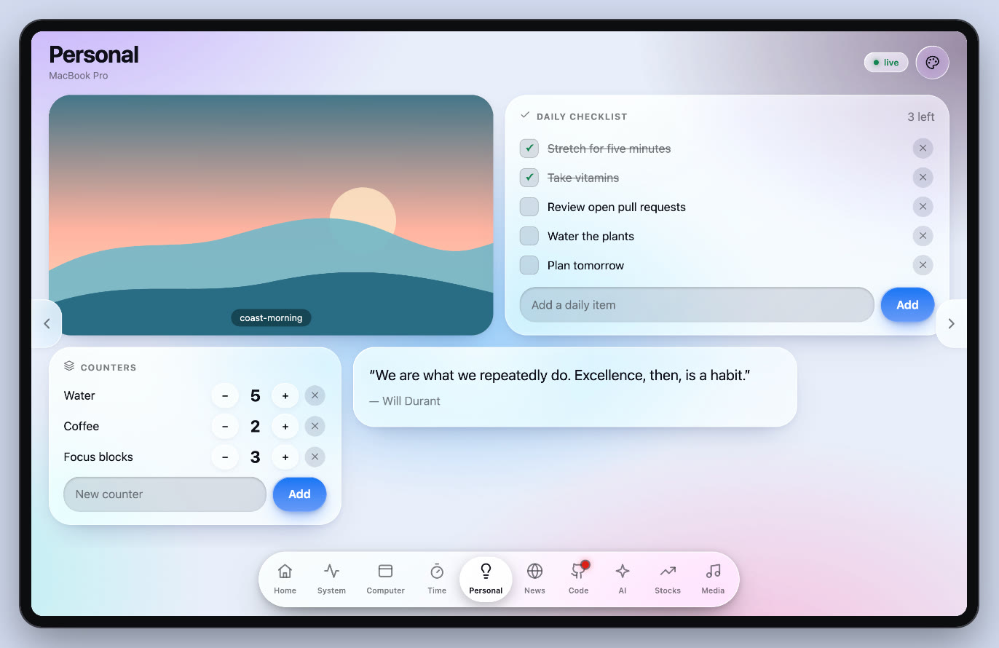</a><br><sub><b>Personal.</b> A photo frame from a folder on your computer, a daily checklist that resets at midnight, counters and a quote.</sub></td>
  </tr>
  <tr>
    <td><a href="docs/img/news.jpg">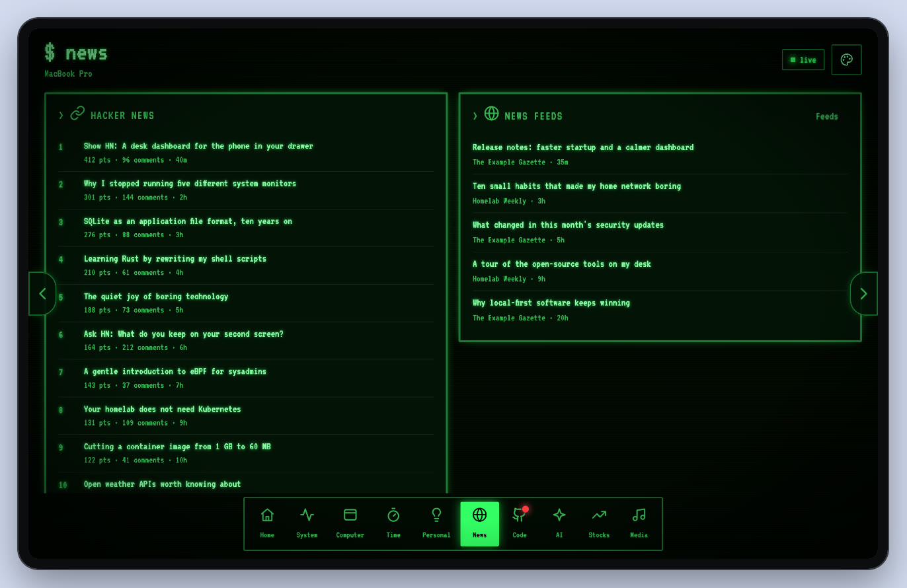</a><br><sub><b>News.</b> Hacker News and your own RSS feeds, plus exchange rates. Feeds can only be public <code>https</code> addresses.</sub></td>
    <td><a href="docs/img/ai.jpg">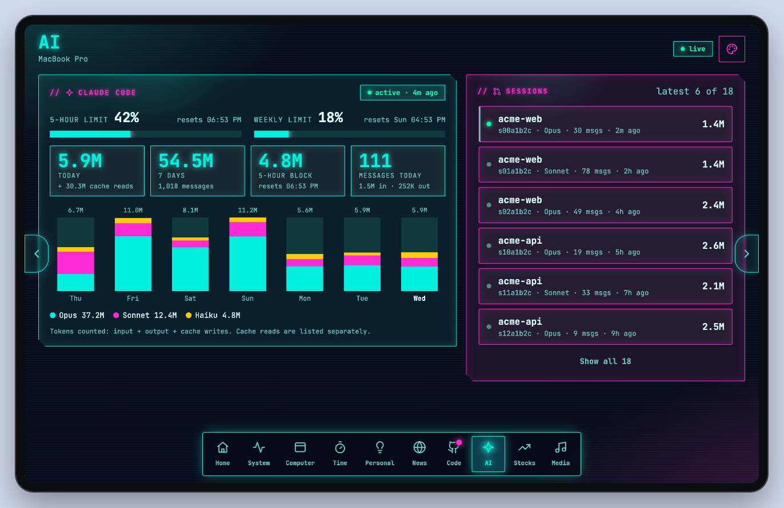</a><br><sub><b>AI.</b> Plan limits, daily usage by model and your latest coding-assistant sessions, read from local logs (token counts only).</sub></td>
  </tr>
  <tr>
    <td><a href="docs/img/code.jpg">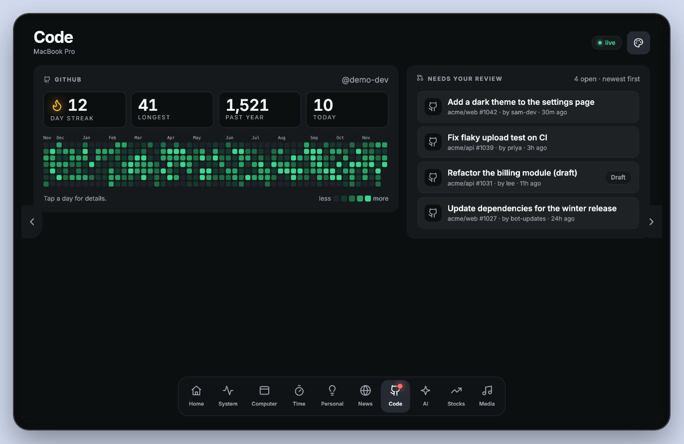</a><br><sub><b>Code.</b> Your contribution heatmap, streaks, and the pull requests waiting for your review.</sub></td>
    <td><a href="docs/img/media.jpg">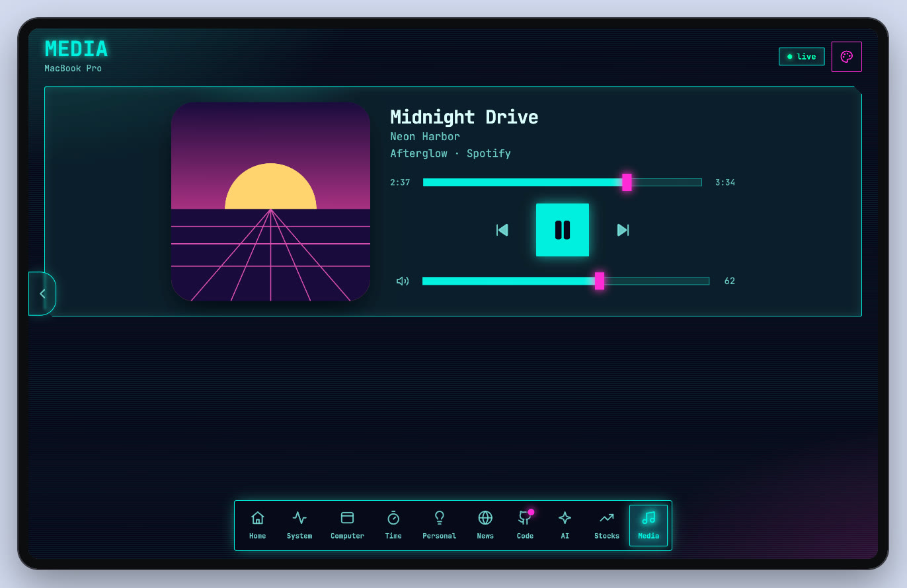</a><br><sub><b>Media.</b> What is playing on your computer, with seek, skip and volume.</sub></td>
  </tr>
</table>

### Six themes

<p align="center">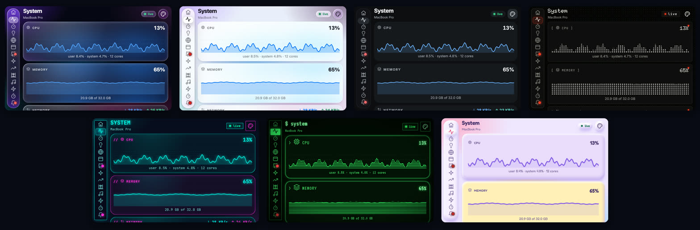</p>

Liquid Glass, Liquid Light, Graphite, Dot Matrix, Cyberdeck and Terminal. Tap the palette button to switch; the choice is remembered per device. There are more pages not shown here (stocks, a 3D printer, shortcuts, notes, notifications, Home Assistant).

## Supported computers

The panel itself runs in Docker anywhere. The computer it **monitors and controls** can be:

| | macOS | Linux | Windows |
|---|---|---|---|
| Status | **Tested** | **Tested** (Debian, in a container over real SSH; sensor parsing against a fake `/sys`) | **Experimental, untested on real hardware** |
| CPU, memory, disk, battery, network, uptime, top processes, quit a process | yes | yes | yes |
| Load average | yes | yes | no |
| Fans, core temperatures | yes | yes (kernel `hwmon` sensors; needs a driver for your hardware) | no (Windows exposes none without a vendor tool) |
| Power draw, battery health | yes | yes (laptops) | yes (laptops) |
| Brightness | yes | yes (`brightnessctl`) | yes (laptop panels) |
| Volume, mute, media keys, now playing | yes | yes (`pactl`, `playerctl`) | yes (through a desktop-session task) |
| Lock, display off | yes | yes | yes (through a desktop-session task) |
| Docker, photo frame, app launcher, your own shortcuts | yes | yes | yes |
| Calendar events | yes | no | no |
| GitHub/GitLab + AI usage pages | yes | yes | no |

Each OS has its own locked-down gate script that returns the same data, so the server and web app are the same everywhere.
Setup is `./host/dashling.sh setup` on macOS and Linux, and `host\windows\dashling.ps1 setup` on Windows. See [host/README.md](host/README.md).

## Quick start

```sh
./host/dashling.sh setup               # one-time, asks before changing anything (see host/README.md; `update` after a git pull)
HOST_SSH=$(whoami)@host.docker.internal docker compose up -d     # pulls the published image, no build needed
docker compose logs -f dashling           # shows pairing codes (and the access token on first run)
```

### Published image or build from source

`docker compose up -d` runs the **published image**, `ghcr.io/sateesh2020/dashling` (multi-architecture: `linux/amd64` and `linux/arm64`, so Intel and ARM Macs, Raspberry Pi and servers). You can also choose to **build it yourself**:

| | Command |
|---|---|
| **Published image** (default) | `docker compose up -d` |
| Pin a version (recommended) | `DASHLING_TAG=0.1.0 docker compose up -d` |
| Update to the newest image | `docker compose pull && docker compose up -d` |
| **Build from this source tree** | `docker compose -f docker-compose.yml -f docker-compose.build.yml up -d --build` |
| Build locally every time | add `COMPOSE_FILE=docker-compose.yml:docker-compose.build.yml` to your `.env` (Windows: use `;` instead of `:`), then `docker compose up -d --build` |

Both options use the same container name and data volume, so you can switch between them without losing your paired devices or settings.
Building from source is for contributors and for anyone who wants to read and audit exactly what runs. The published image is built by CI from a tagged commit (see `.github/workflows/release.yml`).

Open `http://<your-computer-ip>:8787` on your phone or tablet (or enter that address in the Android app), it asks for a 6-digit pairing code. The code is printed in `docker compose logs -f dashling` when the login screen opens (valid 5 minutes, burned after 5 wrong guesses). Once paired, the device keeps its own key and never asks again. Then Add to Home Screen.
Revoke every paired device with `docker compose exec dashling rm /data/devices.json` (the old access token still works as a fallback: tap "Use access token instead").
Devices are not identified by MAC address: a web page can't see it, Android/iOS randomize it per network, and it's trivial to spoof. A per-device key is the safe equivalent.
The host port defaults to 8787; change it with `DASHLING_PORT=9000 docker compose up -d`.

### Android app (recommended)

`android/` has a small kiosk app: landscape only, full screen with no address bar, no HTTPS needed, the screen stays on while charging and sleeps normally on battery, and it wakes by itself when you plug the charger in.

**Get it:** download `dashling-<version>.apk` from the [latest release](https://github.com/sateesh2020/dashling/releases/latest) and open it on the phone (Android will ask you to allow installs from your browser or file manager). Check the download against `SHA256SUMS.txt` on the release page. The APK is signed with the project's key; its certificate SHA-256 is
`21:F4:BD:B1:E7:4E:C3:5C:1D:A7:E7:AE:3A:4E:48:F3:3D:51:68:02:8F:B7:1C:25:92:CF:C6:6B:6A:5E:B8:26` (check with `apksigner verify --print-certs dashling-<version>.apk`). Future releases are signed with the same key, so they update in place.

**Or build it yourself** with `./android/build.sh` (needs the Android command-line tools, ~140 MB download; see `android/README.md`), install with `adb install -r android/dist/dashling.apk`, enter `<your-computer-ip>:8787`, and pair with the 6-digit code. Hold the top-left corner for 1.5 s (or tap with three fingers) to change the address.

The layout adapts to every screen: portrait and landscape phones (the page dock becomes a left rail on short screens), tablets, and desktop browsers.

### Android (Chrome, without the app)

Open `http://<your-computer-ip>:8787` and pair with the code, same as above. Chrome only shows **Install app** on HTTPS or `localhost`, so on a plain `http://` address you'll see "this app cannot be installed". Pick one:

1. **Chrome flag (Wi-Fi, quickest).** On the phone open `chrome://flags/#unsafely-treat-insecure-origin-as-secure`, enable it, type `http://<your-computer-ip>:8787` in the box, relaunch Chrome and reload the page. Give the Mac a fixed IP in your router so the address doesn't change. This only affects that phone.
2. **USB.** Run `adb reverse tcp:8787 tcp:8787` on the Mac with the phone plugged in (USB debugging on), then open `http://localhost:8787`. Chrome treats localhost as secure, so install works with no flags. It only works while the cable is connected.
3. **Tailscale HTTPS.** Install Tailscale on the Mac and phone, run `tailscale serve --bg 8787` on the Mac, and open the `https://<mac>.<tailnet>.ts.net` address it prints. Installs cleanly and also works away from home.

Then tap the Chrome menu, **Install app**. The panel also works without installing; you just keep the browser bars. The browser version has no keep-awake control, so raise the phone's screen timeout (the Android app keeps the screen on by itself).

## Admin page

Open **http://localhost:8788** on the computer that runs Docker (change the port with `DASHLING_ADMIN_PORT`). It is published on the loopback interface only, so phones and other machines on your network cannot reach it, and the panel's own port refuses `/admin`.

- **Layout**: add, rename, reorder and delete pages; drag widgets between pages (or use the arrows / "Add to…"); set each widget's width; park widgets you don't want in *Unplaced*. Export/import the layout as JSON.
- **Connections**: Mac login (SSH), Home Assistant, 3D printer and GitHub token, each with a *Test connection* button. Secrets are write-only: they are stored server-side and never sent back to the browser.
- **Devices**: generate a pairing code without reading the terminal, see paired devices and revoke one or all.
- **Diagnostics / Logs**: live connectivity checks, server info (data folder writable?), a test notification, cache reset, and the last 300 server log lines.

Everything you save lives in the `dashling-data` volume (`layout.json`, `connections.json`), so it survives restarts and rebuilds. Panels pick up a new layout within about 15 seconds. Values saved on the Connections tab override the matching environment variables in `docker-compose.yml`.

## Security model

- **No agent on your Mac.** The container connects over the Mac's built-in SSH using a dedicated key.
  That key can only run `host/<your OS>/dashling-gate.*` (enforced in `authorized_keys`), which allows
  exactly two things: `stats` and `volume-set 0-100`. Everything else is refused. Read the script, it is ~40 lines.
- Container runs as non-root, read-only filesystem, all capabilities dropped, no-new-privileges,
  128 MB / 100 process limits, no Docker socket, zero npm dependencies.
- API requires a bearer token (timing-safe compare, 10 failed tries/min/IP limit). Strict CSP, no inline scripts.
- Revoke any time: delete the `dashling-container` line from `~/.ssh/authorized_keys`.

**HTTPS:** iOS only enables some PWA features (service worker) on HTTPS or localhost.
On plain `http://192.168.x.x` the panel works, but offline caching may not.
Put it behind Tailscale (`tailscale serve --bg 8787` gives a trusted HTTPS URL) or a reverse proxy.
Don't expose port 8787 to the internet directly.

## Widgets
Clock, CPU, memory, disk, battery, weather (Open-Meteo, set your city in the card), timer and pomodoro,
Mac volume, notes, control deck, notifications, pushed values, Home Assistant tiles.

## Themes
Tap the palette button in the top bar: **Liquid Glass**, **Graphite** (flat, amber, DeskHub style), **Dot Matrix**, **Cyberdeck** and **Terminal** (the last three inspired by dustyPad). Saved per device.

### System graphs, GitHub, printer, shortcuts
- **System**: live CPU, memory and network graphs (last ~5 minutes, kept on the server so reloads don't lose them). Network needs the updated gate script: re-run `./host/dashling.sh update` after pulling.
- **Code**: a "Needs your review" list (GitHub PRs and GitLab merge requests where you're a requested reviewer, with a dot on the dock icon when any are waiting), plus separate GitHub and GitLab cards, each with its own contribution calendar and streaks. It uses the `gh` and `glab` logins already on your Mac, with no token copied anywhere. A background job (installed by `dashling.sh setup`) refreshes the data every 15 minutes in your desktop session, where the keychain is unlocked, and the SSH gate serves the cached result. Without a Mac connected, set `GITHUB_USER` and `GITHUB_TOKEN` instead (GitHub only). GitLab counts activity events (pushes, merge requests, comments), so totals won't match GitLab's own graph.
- **AI**: one card per coding tool, each split 60/40: usage graphs on the left (tokens today and over 7 days, the current 5-hour block, a per-model daily chart, plan limits when available) and the latest sessions on the right (project, model, messages, tokens; "Show all" expands the list). Supported: **Claude Code** (reads `~/.claude/projects`) and **Codex** (reads `~/.codex/sessions`, including its 5-hour and weekly limits). A tool's card appears only when its logs exist on the Mac. Only token counts, model names, timestamps, session ids and project folder names are read; message text is never kept. Collected incrementally by the background job (the first scan of large logs can take several minutes; later runs take under a second). Needs `jq` (built in on macOS 15+). **Claude plan limits** (5-hour and weekly % used, with reset times) come from an optional status-line hook: `./host/dashling.sh statusline` (also offered by `dashling.sh setup`). It backs up `~/.claude/settings.json`, sets only `statusLine`, and keeps any status line you already had (it wraps it, so your output is unchanged). Undo with `./host/dashling.sh statusline --remove`. The Codex collector follows Codex's log format as documented by the deskhub project and is tested against synthetic logs only. Antigravity, Gemini and Copilot keep no usable usage data locally, so they are not supported yet. Add a tool by writing an extractor in `host/common/ai-usage-sync.sh`.
- **Stocks**: an editable watchlist with price, daily change and a sparkline per ticker (1D / 5D / 1M / 1Y), in each ticker's own currency. Search by company name or symbol; markets worldwide work (`RELIANCE.NS`, `TCS.BO`, `7203.T`, `SAP.DE`, `VOD.L`, `0700.HK`, `AAPL`, indexes like `^NSEI`, crypto like `BTC-USD`). Data comes from Yahoo Finance's unofficial, keyless endpoints, fetched by the server and cached for a minute; only ticker symbols are sent. It is unofficial, so it may change or rate-limit, and some exchanges are delayed. Not financial advice.
- **Printer**: Moonraker (Klipper) or OctoPrint. Set `PRINTER_URL`, `PRINTER_TYPE` (`moonraker` default, or `octoprint`) and `PRINTER_API_KEY` for OctoPrint. Shows progress, temperatures, pause/resume/cancel (cancel needs two taps).
- **Shortcuts**: tap Edit to add your own tiles: links or URL schemes (e.g. `shortcuts://run-shortcut?name=…`), Mac apps from `apps.allow`, Home Assistant toggles, or media actions. Stored on the server.

### Control deck
Prev / play-pause / next / mute / sleep display, plus buttons to open apps. Now Playing, album art and the media buttons work with **Spotify, Apple Music and anything that reports to macOS,
including YouTube in Chrome/Safari/Arc/Firefox, VLC and Podcasts**, via `brew install nowplaying-cli`.
Spotify and Music are driven directly through AppleScript (accurate position); everything else goes through
`nowplaying-cli`. Browsers don't publish their playback position, so the progress bar is estimated from the clock.
Apps listed in `~/.dashling/apps.allow` on the Mac (one per line, exact name)
are the only ones the panel can open; the container cannot edit that file. Re-run `./host/dashling.sh update`
after pulling updates so the Mac has the latest `dashling-gate.sh`.

### Notifications and values (webhooks)
Automations use a **separate** key from the panel token. It can only post, never read or control anything.
```sh
WT=$(docker compose exec -T dashling cat /data/webhook_token)
curl -X POST localhost:8787/api/push  -H "Authorization: Bearer $WT" -d '{"title":"Build","message":"CI passed","level":"info"}'   # level: info|warn|error
curl -X POST localhost:8787/api/value -H "Authorization: Bearer $WT" -d '{"key":"temp","label":"Server temp","value":"41","unit":"C"}'
```
Notifications are kept in memory (last 20) and clear on restart.

### Home Assistant
Set `HA_URL`, `HA_TOKEN` (a long-lived token) and `HA_ENTITIES` (comma list, e.g. `light.desk,switch.fan`) when
running compose. Only those entities appear and can be toggled; the token never reaches the browser.

## Develop
```sh
DATA_DIR=./.data DASHLING_TOKEN=dev node server/index.js
node scripts/make-icons.mjs   # regenerate icons
```

## Credits
Dashling is its own code, but it borrows ideas and visual direction from these projects. It isn't affiliated with any of them.
- [ersinkoc/phonebox](https://github.com/ersinkoc/phonebox): the original idea of turning a spare phone or tablet into a desk panel.
- [zacharyinserra/deskhub](https://github.com/zacharyinserra/deskhub): the widget layout, the GitHub streak and contribution view, the CPU, memory and network graphs, 3D printer status, shortcuts, and the flat **Graphite** look.
- [dustyPad](https://dustypad.com): the **Dot Matrix**, **Cyberdeck** and **Terminal** themes.
- Fonts are bundled from [Fontsource](https://fontsource.org): Inter, JetBrains Mono, Doto and VT323, all under the SIL Open Font License (see [THIRD_PARTY_NOTICES.md](THIRD_PARTY_NOTICES.md)).

## Contributing

Contributions are welcome, especially **platform reports for Linux and Windows**. See [CONTRIBUTING.md](CONTRIBUTING.md) for setup, the checks (`npm run check`), and how to add a widget or a gate command safely; [docs/ARCHITECTURE.md](docs/ARCHITECTURE.md) explains how the pieces fit; report security problems privately as described in [SECURITY.md](SECURITY.md). Licensed under the [MIT License](LICENSE).
